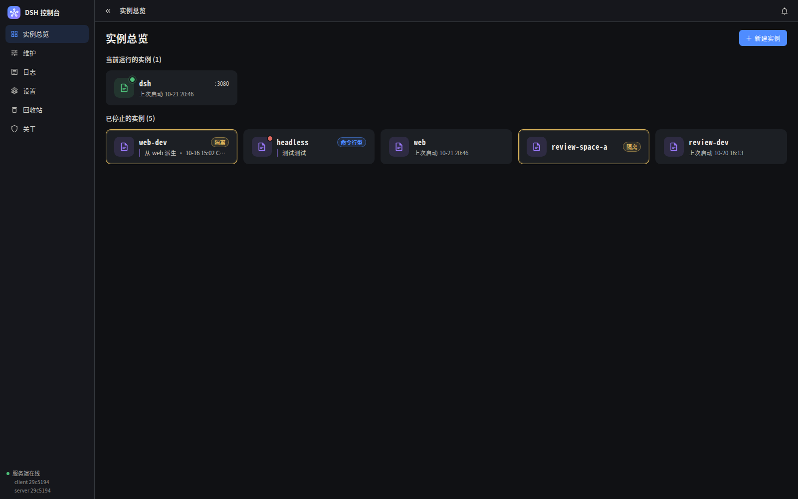

# DSH Console

[中文](README.md) · [](https://github.com/conglinyizhi/dsh-console/actions/workflows/ci.yml) · [](LICENSE)



A graphical console for DSH (DeepSeek Harness) running on your own machine. One MoonBit native
backend plus one rabbita frontend: the backend serves the read-only API, the write actions and the
static assets, so the frontend it ships is served from the same port. No second server to start.

**What is DSH?** DSH (DeepSeek Harness) is an AI agent runtime you run locally. It keeps each of
its setups — called profiles — under `~/.dsh`, writes logs there, and can have several instances
running at once, each on its own port with its own profile.

**What is this repo?** The GUI for that runtime. It reads the profiles and logs under `~/.dsh`,
detects DSH instances already running on this machine, starts and stops instances on demand, and
manages profiles (fork / rename / archive / delete / note) plus a set of console preferences.

**Who is it for?** People running DSH locally who would rather see and click than read logs in a
terminal, assemble `dsh` commands by hand, or count profiles in `~/.dsh`. It serves this machine
only — it is not meant to become a remote dashboard.

## Getting started

You need: a MoonBit toolchain (`moon`), a C compiler (native builds need one: clang or gcc),
and bash with gzip for the frontend build. Node is only needed for the acceptance run.

```bash
# 1) Build the frontend (output goes to frontend/dist)
cd frontend && ./build.sh

# 2) Build the backend (output: backend/_build/native/debug/build/dsh-console-backend.exe)
cd ../backend && moon build --target native

# 3) Start the server (the static root walks up to frontend/dist on its own, no env var needed)
./_build/native/debug/build/dsh-console-backend.exe
# → http://127.0.0.1:5390/
```

> On the machine this repo is developed on, `~/.moon` is mounted read-only, so moon cannot write its
> registry cache and local builds run inside each directory's `.sandbox/moonhome`
> (`frontend/build.sh` defaults to it; for the backend you add `MOON_HOME=$PWD/.sandbox/moonhome`
> yourself). Machines with a writable `~/.moon`, and CI, do not need this. The frontend
> `build.sh` also exports `MOON_CC=clang MOON_AR=ar MOON_LD=clang` on its own; if the default C
> toolchain is not what you want for a manual backend build, copy those three.

Port and static root can be overridden with environment variables
(`DSH_CONSOLE_BACKEND_HOST` / `DSH_CONSOLE_BACKEND_PORT` / `DSH_CONSOLE_DIST`); details in
[backend/README.md](backend/README.md).

## What it does

**Look** (read-only GET endpoints): running instances (port / profile / version / DSH_HOME /
uptime / handshake URL), profiles on disk (patch line count, lock timestamp, declared and installed
bundles, missing bundles, notes), logs (host / audit / a single instance), local processes, and the
console's own readings.

**Manage** (write actions, all through `POST /api/local/action`): start / stop / restart an
instance, fork a copy, rename, edit notes, archive / unarchive, delete, open the working directory /
open the config file.

**Recover**: the "Trash" item in the sidebar (`/trash`) lists every deleted item that went to the
trash (profile name, deletion time, file count, size) and can restore it to the profile directory or
purge it. The receipt after a delete only says "moved to trash / deleted"; paths and `mode` stay in
the hover text instead of the body.

**Configure**: twelve settings (probe timeout, probe concurrency, candidate port cap, starting port,
process detach and stop grace, default log tail, whether the archive group starts expanded, the beta
feature switch, whether the wide-screen sidebar collapses, missing-bundle warnings, whether deletes
go to trash) — **each one is wired to real behavior**.

## Security boundary (stated honestly, not a login)

- Binds `127.0.0.1` only, **no account system**
- Write actions require the `X-DSH-Console: 1` header plus an `Origin` check — that stops a
  cross-origin browser page from triggering them, and **does not stop other local processes**
  (that layer is out of scope for now)
- Deletes go to the trash by default (`safety.deleteToTrash`); a hard delete requires
  `confirm: "DELETE"` in the request, and purging one trashed item requires `confirm: "PURGE"`
  (both read from the **top level** of the body)
- "Open working directory / open config" only accept enumerated targets (profile name + kind),
  **never a path supplied by the client**
- Instances start detached by default: **kill the console and the instances it started keep running**
  (verified on a real machine)
- An instance's handshake token is read from its startup log and **only used to build the
  "Open Web UI" URL; it is never written to the audit log or into hover text**

## Where data lives

```
$XDG_STATE_HOME/dsh-console/     settings.json  preferences
                                 runtime.json   instances this console started
                                 archive.json   archive records
                                 audit.jsonl    audit (append-only; rolls over past a limit)
                                 trash/         where deleted items go
~/.dsh/                          your own DSH directory (profiles / logs / sessions)
~/.dsh/logs/console-<profile>-<port>.log   stdout/stderr of an instance started by the console
```

## Repository layout

```
backend/    MoonBit native backend: read-only API + write actions + static serving (gzip and history fallback)
frontend/   rabbita frontend (js target) + SCSS compiled by precss; icons are inline SVG
design/     acceptance rig: one-shot acceptance run, probes, the Vue baseline, API contract, backlog, decision records
VERSION     console version (the backend reads it; this is what the About page shows)
```

## Acceptance

```bash
node design/run-acceptance.mjs http://127.0.0.1:5390/
```

One command runs twenty-odd checks: geometry invariants (status dots aligned across cards, button
group's right edge flush with the content edge, menu anchors), interactions (dialog centered and
clickable on top, cancel and overlay click close it, every menu item reachable), logs (scrolling,
level colors, source dropdown covering all running instances), motion and class-name contracts.
**The probes themselves were verified too**: run against the old baseline with the Vue version, the
same set of checks passes.

The rig and decision records live in `design/`: `write-api-contract.md` (API contract),
`backlog.md` (todos and open verification), `frontend-parity-checklist.md` (parity checklist
against the Vue version).

## Continuous integration

[.github/workflows/ci.yml](.github/workflows/ci.yml) runs on pushes to `main` and on pull requests,
with a matrix of `ubuntu-latest` / `macos-latest` / `windows-latest`. On all three it runs
`moon check`, `moon test` (native target) and `moon build --target native` in `backend/`. The
frontend is built on ubuntu and macos only (`frontend/build.sh` needs bash, gzip, find and wc).
The MoonBit toolchain comes from the official install script, and concurrency cancels stale runs
on the same branch.

## Known limits (unverified or out of reach)

- **Externally started instances have no readable handshake token**: the token is printed in the
  terminal that started them, and the console has no way to read it. For those instances "Open Web
  UI" explains why and gives the bare URL instead of a link that lands on a 401.
- **The permission-denied (EACCES) branch has not been exercised for real**: every process in the
  sandbox belongs to us, so a genuine permission denial cannot be produced. The code is there, but
  unverified.
- **Multi-user / hidepid setups are not covered**: when `/proc` cannot see other users' processes,
  only the port can be filled in.
- **Routing is path-based** (`/settings/safety`). Typing the hash form (`#/settings`) lands on the
  home page; there is no alias parsing.
- **First paint relies on gzip**: `app.js` is about 1.5 MB, about 170 KB compressed (the backend
  serves the `.gz` when `Accept-Encoding` allows it). Icons are already inline SVG; there are no
  font files.
- During acceptance the motion probe clicks "Start" once; hitting a profile that cannot start
  (e.g. `headless`) leaves a one-line failure log in `~/.dsh/logs/`. The probe stops the instances
  it started, but **cannot clean up that failure log**.
- **Developed and tested on Linux only**: the code type-checks on macOS and Windows (CI runs all
  three), but the runtime depends on Linux `/proc`: instance detection, process ownership and
  stopping instances have no other-platform implementation and remain unverified.

## License

This repository (dsh-console) is released under the **MIT** license, see [LICENSE](LICENSE).
Copyright (c) 2026 Clzhi.

Dependencies (all Apache-2.0, compatible with this repository's MIT):

- [moonbitlang/core](https://github.com/moonbitlang/core) (MoonBit standard library and runtime) — Apache-2.0
- [moonbit-community/rabbita](https://mooncakes.io/docs/#/moonbit-community/rabbita) 0.15.7 (frontend framework) — Apache-2.0
- [conglinyizhi/precss](https://mooncakes.io/docs/#/conglinyizhi/precss) 0.1.4 (style compilation) — Apache-2.0
- [moonbitlang/moonback](https://mooncakes.io/docs/#/moonbitlang/moonback) 0.8.6 (HTTP server) — Apache-2.0
- [moonbitlang/async](https://mooncakes.io/docs/#/moonbitlang/async) 0.22.4 / 0.21.2 (async IO) — Apache-2.0

Third-party material:

- Icon path data comes from **@mdi/js 7.4.47** (Pictogrammers, Apache-2.0 / Pictogrammers Free
  License). Provenance and copyright notice:
  [frontend/vendor/licenses/mdi-NOTICE.md](frontend/vendor/licenses/mdi-NOTICE.md). The repository
  only pins 26 SVG path constants; no upstream font or stylesheet is distributed.

> Note: the dependency licenses above rest on the `license` declaration in the MoonBit package
> registry (all Apache-2.0). The LICENSE text of the exact package versions is not distributed with
> this repository; fetching the package requires network access.
