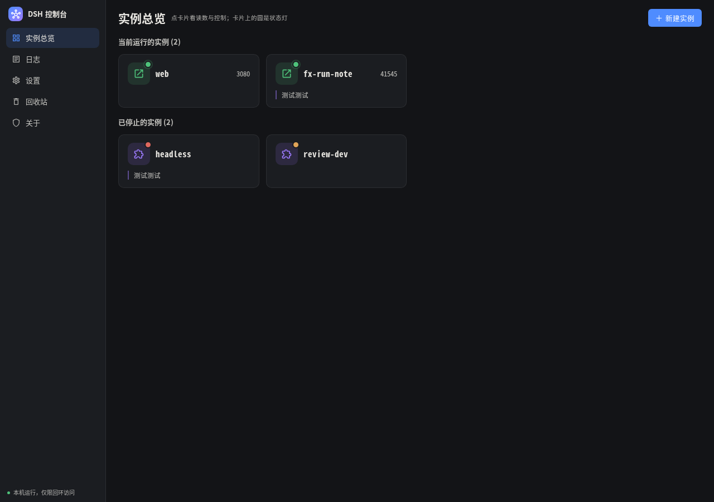
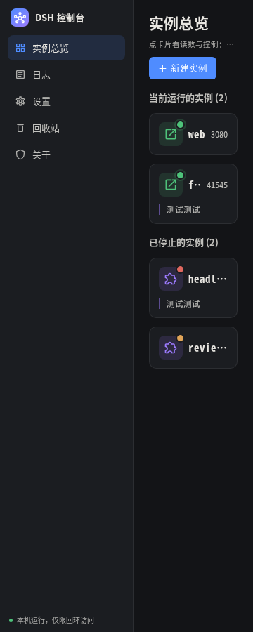

# 条目里三样东西的摆位：左上名字、右上端口、下面备注

使用者原话：「改一下，左上角写名称，右上角写端口号（如果已经运行）；下面的横线写备注，如果有」，
配图是在条目上画的两条红线：一条在名字右侧（要写端口），一条在下面的备注行。
改之前 `web :3080` 是拼成一串写在名字位上的；备注行前面还挂着一个「备注」标。

## 改了什么

| 位置 | 内容 | 什么时候有 |
| --- | --- | --- |
| 左上 | profile 名（只有名字，不再带 `:端口`） | 每条都有 |
| 右上 | 端口号（`3080` 这样的数字） | **只在运行中那一条**；没在跑就不产出这个节点 |
| 下面一行 | 备注 | **有才显示**；没有就一个节点都不产出 |
| 图标右上角 | 状态灯（那颗实心圆） | 原样不动 —— 与条目右上角的端口是**两处**位置 |

备注行左侧那道细线**保留**（那是「这是人写的」的记号）；「备注」两个字去掉了 ——
这一行整个就是备注，标签是把同一句话说两遍；抽屉里那一处上面还有分组标题「备注」顶着。
备注行**不参与**「同列状态点对齐」那条不变量：`probe-invariants.mjs` 量的还是 `.dsh-dot` 的 x。

## 怎么跑

```bash
cd dsh-console/frontend/evidence-card-layout
node probe-layout.mjs http://127.0.0.1:5390/ fixture cases   # 四情况：特写 + DOM 文本 + 逐项几何
node probe-layout.mjs http://127.0.0.1:5390/ real real       # 不注入：量这台上真有的那几种组合
node compare-bundles.mjs http://127.0.0.1:5390/ /tmp/dsh-before/frontend/dist/assets \
  ../dist/assets bundle                                      # 改前/改后两份产物逐项相减
```

改前那份产物是现编出来的（不是我嘴上说的「改前」）：

```bash
git archive <改动前的提交> frontend | tar -x -C /tmp/dsh-before
cp -r frontend/.mooncakes /tmp/dsh-before/frontend/.mooncakes
cd /tmp/dsh-before/frontend && MOON_HOME=<原目录>/.sandbox/moonhome ./build.sh
```

`compare-bundles.mjs` 用 CDP 在**请求阶段**顶替 `/assets/app.js` 与 `/assets/app.css` 两个响应，
同一条 URL、同一份实时读数、同一个视口，只换产物 —— 量两遍再逐项相减。

## 一、四种情况（一张总图 + 四张特写）



| 情况 | 卡片 | 灯 | 条目尺寸（1280，4 列） | 特写 |
| --- | --- | --- | --- | --- |
| 运行中 + 无备注 | `web` + 右上 `3080` | 绿 | 252.5×96（同行有带备注的卡，被栅格拉齐） | `cases-running+none.png` |
| 运行中 + 有备注 | `fx-run-note` + 右上 `41545` | 绿 | 252.5×96 | `cases-running+note.png` |
| 已停止 + 有备注 | `headless` | 红 | 252.5×96 | `cases-stopped+note.png` |
| 已停止 + 无备注 | `review-dev` | 黄（缺包） | 252.5×96 | `cases-stopped+none.png` |

**DOM 文本**（`cases.json` 的 `text`，逐字摘录）：

```
运行中 + 无备注   web3080
运行中 + 有备注   fx-run-note41545测试测试
已停止 + 有备注   headless测试测试          ← 改前是 headless备注测试测试
已停止 + 无备注   review-dev
```

节点（`cases.json` 的 `nodes`）：运行中的两张 `port:true`，已停止的两张 `port:false`；
四张 `noteTag:false`（「备注」标一个都不剩）；四张 `dot:true`（灯都还在原处）。

### 这张图里哪些是造的（如实说）

`fixture.mjs` 只造了两件东西，其余全是真读数：

- **造**：instance `proc-41545`（字段照抄真实例 3080 那一行，只改 id / port / url / profile）
  与 profile `fx-run-note`（字段照抄 `headless`，备注文本与来源照抄它的 `测试测试` / `文件`）
- **真**：`web`（真实例 3080，无备注）、`headless`（真 profile，备注读自它自己的目录）、`review-dev`（真 profile）

为什么非造不可：本机唯一带备注的 profile（`headless`）当时没有在跑，而给一只真在跑的 profile 写备注
要往使用者的 profile 目录里落文件 —— 不许碰。所以「运行中 + 有备注」这一种只能在浏览器这一侧造出来。
注入点在 `window.fetch` 上，只换 `instances` / `profiles` 两份读数，页面与渲染路径都是真的。

## 二、量到的数（1280，`cases.json`）

| 量什么 | 期望 | 实测（四情况） |
| --- | --- | --- |
| 名字左缘 − 内容盒左缘 | 图标位 40 + 间距 10 = **50** | 50 / 50 / 50 / 50 |
| 端口右缘 − 内容盒右缘 | **0**（贴着内容盒右缘） | 0（两张运行卡）；已停止的两张没有端口节点 |
| 端口与名字之间 | 卡片 flex gap = 10 | 10 |
| 备注行左缘 − 内容盒左缘 | **0**（它自己那道 2px 细线在里侧） | 0 / 0 |
| 备注正文左缘 − 内容盒左缘 | 2（线）+ 9（左内边距）= **11** | 11 / 11 |
| 备注行上缘 − 卡头下缘 | 卡片 flex gap = **10** | 10 / 10 |
| 灯的右下角相对图标位 | dx 30 / dy −3 / 右缘 +3（保持原样） | 四张完全一致 |
| 端口右缘不齐或换行的卡 | 0 | 1280 / 768 / 360 三档都是 0 |

**宽高**：栅格会把同一行的卡拉齐，所以 1280 / 768 上四张都是 96。要看**卡片自己的高度**得看单列那一档
（360，1 列 = 每张卡一行）：**无备注 60 / 有备注 86**，差 26 = 间距 10 + 备注行 16 ——
除备注行那点高度差之外，四种情况逐项相同（宽 126 全等，图标位与内边距一个像素不差）。宽档同理：70 / 96。

## 三、「没有备注的条目与改动前逐像素一致」（产物对照，`bundle.json`）

同一条 URL、同一份实时读数、只换编译产物，量两遍相减（1280 与 360 各一遍）：

| 卡片 | 情况 | 改前 → 改后 |
| --- | --- | --- |
| `dsh-card-port-3080` | 运行中 + 无备注 | 卡片盒 `252.5×70@212,96.7` → **同**；内容盒 / 卡头 / 图标位 / 灯 / 名字的左缘与顶缘 **全同**；名字那一段宽度 168.5 → 134.5（腾给端口）；新增端口节点 |
| `dsh-card-profile-headless` | 已停止 + 有备注 | 卡片盒 `252.5×96@212,214.8` → **同**；备注行 `229 / 218.5 / 16` → **同**；「备注」标节点消失；备注正文左缘 268.6 → 240（左移 28.6 = 标签宽 + 7 间距，那一行因此多出 28.6px 给正文） |
| `dsh-card-profile-review-dev` | 已停止 + 无备注 | **逐项相同**（含名字盒与文本；360 档也一样） |

也就是说：**已停止的条目一个像素都没动**；运行中的条目卡片盒（宽高、内边距、图标位、灯的落点）也没动，
变的只有名字那一段让出右侧给端口 —— 这正是这一轮要的改动本身。
`bundle-diff.json` 是逐项差值的原始记录。

## 四、窄屏 360 / 768：端口挤不掉、不换行



| 视口 | 列数 | 端口右缘 − 内容盒右缘 | 端口行数（`getClientRects`） | 页面横向溢出 |
| --- | --- | --- | --- | --- |
| 360 | 1 | 0 / 0 | 1 / 1 | false |
| 768 | 2 | 0 / 0 | 1 / 1 | false |
| 1280 | 4 | 0 / 0 | 1 / 1 | false |

360 下条目只有 126px 宽，运行中那张的名字剩 24px（省略号），端口 24px 一个像素不少、一行不折；
`web` 这个名字还是认得出的（`cases-360.png`）。端口那一格 `flex: none` + `nowrap`，名字 `flex: 1 1 auto` +
`min-width: 0` 先让 —— 挤不掉也不换行的来路就在这两条上。

## 五、骨架屏（「与条目同形」那条不许退）

`evidence-loading-skeleton/probe-skeleton.mjs` 原样跑（探针一个字没改，输出前缀指到本目录，
不往那个目录里写东西）：

| 视口 | 加载态占位块 | 放行后卡片高度 | 列轨（加载 / 放行） | 主区宽（加载 / 放行） |
| --- | --- | --- | --- | --- |
| 1280 | 12 个，252.5×**70** | 252.5×[**70**, 96] | [4,4] / [4,4] | 1090 / 1090 |
| 1920 | 12 个，271×**70** | 271×[**70**, 96] | [6,6] / [6,6] | 1730 / 1730 |
| 768 | 12 个，261×**70** | 261×[**70**, 96] | [2,2] / [2,2] | 578 / 578 |
| 360 | 12 个，126×**60** | 126×[**60**, 86] | [1,1] / [1,1] | 170 / 170 |

占位块的高度仍然是「**没有备注**的真卡片」的高度（70 / 60），宽度与列轨与真卡片逐项相同 ——
这一轮没碰 `view_parts.mbt` 的占位块，也没给它加端口那一格（加载时还不知道哪一条在跑，
摆一个假的端口位置只会骗眼睛；端口那格 16px 高 < 图标位 40，本来就不进高度）。

## 六、新增的可见文案

**只有端口号本身**（`3080` / `41545` 这样的数字），没有新增一个字的中文标签。

- 没有新增悬停 / aria 文案：端口那一格没有 `title`；卡片自己的 `aria-label` 里本来就有 `web :3080` 这一串，
  状态灯的 `aria-label`（运行中 / 故障 / 已停止 / 未知）也没动。
- **减少**的可见文案：「备注」这两个字（卡片备注行与抽屉备注段各一处）。

## 七、这一轮不判什么

- `等待态动效与禁用` 那一条仍然是**未判**（`run-acceptance.mjs` 里如实记为信息）—— 这一轮没碰动效，也没补探针。
- 「运行中 + 有备注」这一路的实例行是造的（见第一节）：它验的是**摆位**，不是读数。
- 窄屏那两张图（`cases-360.png` / `cases-768.png`）是 fixture 那一趟拍的；
  不注入那一趟（`real.log` / `real.json`）同样三种情况齐全、端口右缘同样为 0。

## 八、构建与验收

```bash
cd dsh-console/frontend && ./check.sh        # moon check --target js + build.sh：0 error（日志见 check-sh.log）
cd ../design && node run-acceptance.mjs http://127.0.0.1:5390/ /tmp/acc-final
```

改动前先跑过一遍基线（同一台控制台、同一份实时读数）：**30 项判定全过 + 6 条信息**；
改完再跑：**30 项判定全过（失败 0）+ 6 条信息**，逐条一致。两份日志都在本目录：
`acceptance-5390-before.log`（改前）、`acceptance-5390.log`（改后）。

其中与这一次改动直接相关的几条：`卡片上没有按钮` 全 0（端口那一格是 span，不是按钮）、
`卡片上没有 ⋯ 菜单与字段` 全 0、`同列状态点对齐` 2 列全等、`宽屏同列状态点对齐` 2 列全等、
`类名契约候选（无规则的类）` 无（新加的 `.dsh-card-port` 有规则；去掉的 `.dsh-card-note-tag` 连规则一起删了）。

动效那两条在验收里的状态原样没动：`点击前无可见动效` 通过（0 个可见动效），
`等待态动效与禁用` 仍然是**未判**（记为信息）—— 这一轮没碰动效，也没补探针。