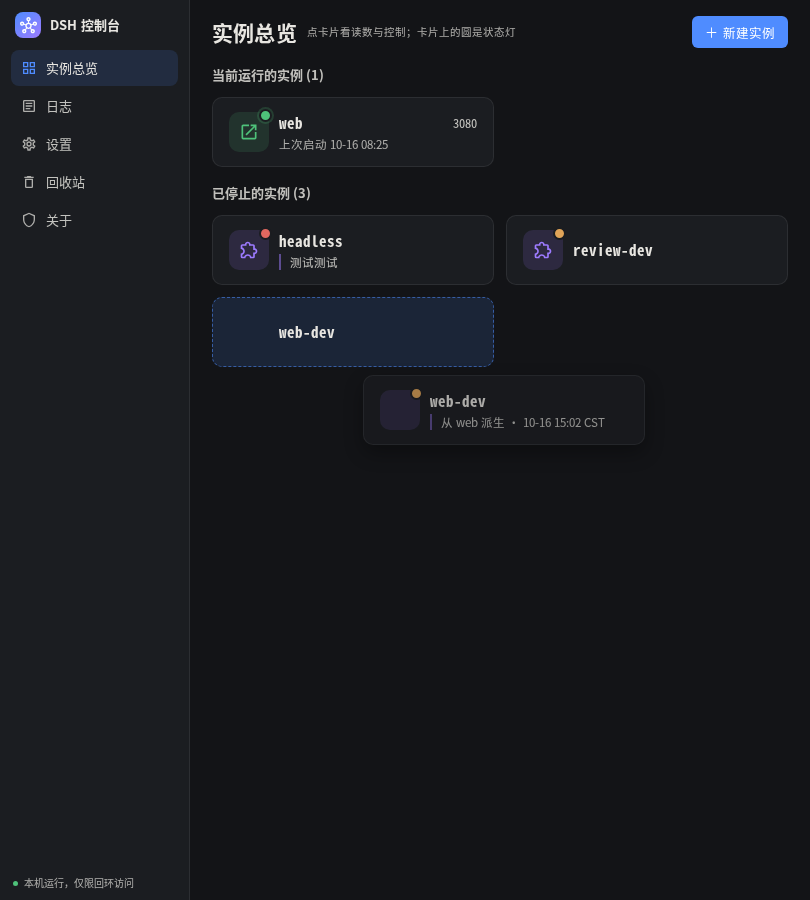

# 拖动排序的落点预览：预览就是结果

使用者原话：「调整顺序的时候，使用虚拟元素来提示用户大概会放在哪儿，而不是仅仅使用一根线；
而且，这个线表示的拖动算法也不直观」。

改之前：落点提示是**目标条目上一条 2px 的插入线**（`::after`，画在盒子外面、落在 12px 的
栅格间隙里）。两个毛病 —— 一根线看不出会插到第几位；而「指针越过谁的中间线就插到谁前面」
这句判定藏在代码里，画面上看不见，只能猜。

改之后：**跟着指针的半透明虚影 + 落在将来那一格上的占位块**，其余条目真的让开一格。
松手落在占位块那一格 —— 预览与结果逐格一致，这是这一轮的验收核心。

## 怎么跑

```bash
cd dsh-console/frontend && ./check.sh          # moon check + build.sh
cd ../design
# 隔离的后端（自己的状态目录，不碰使用者的 ~/.local/state/dsh-console）：
cd ../backend && XDG_STATE_HOME=/tmp/dsh-drag-iso DSH_CONSOLE_BACKEND_PORT=5391 \
  ./_build/native/debug/build/dsh-console-backend.exe &
# 探针（真指针 CDP 按下 / 移动 / 松开，逐帧采一次）：
cd ../design && DRAG_STATE_DIR=/tmp/dsh-drag-iso \
  node probe-drag-preview.mjs http://127.0.0.1:5391/ ../frontend/evidence-drag-preview/drag-preview-5533.json
# 旧那套（点击 / 窄屏 / 跨组 / 写回失败回滚 / 键盘）继续跑，只看落点提示那几行换了读法：
DRAG_STATE_DIR=/tmp/dsh-drag-iso DRAG_SECTIONS=drag,stuck,narrow,click,keyboard \
  node probe-drag-order.mjs http://127.0.0.1:5391/ ../frontend/evidence-drag-preview/drag-legacy-5533.json
cd .. && node design/run-acceptance.mjs http://127.0.0.1:5390/ /tmp/acc
```

**为什么另起一个后端**：`order.json` 写在 `$XDG_STATE_HOME/dsh-console/` 下，而 5390 那台
用的是使用者的状态目录。拖动会真写一份顺序表，所以这一轮的实测全跑在 5391（自己的
`XDG_STATE_HOME`）上；5390 只用来跑验收（它不写顺序表）。



（上图：占位块（虚线蓝框）落在第 2 格，`web-dev` 的半透明虚影偏在指针右下，
另外两条已经让开。整幅在 810 宽（两列）下。）

## 一、预览与结果逐格一致（三个不同落点各一次）

`drag-preview-5533.json`：810 宽（两列，这一组折成两行）下真指针拖三趟，每 55ms 采一帧、共 10 帧。
「格子序号」是从**画面**上量的：把这一格里的每一块按「先 y 后 x」排一遍，看占位块排第几 ——
不是数 DOM 顺序（虚拟 DOM 那一层会重排孩子，靠位置数会数错）。

| 趟 | 松手点 | 占位块画在第几格 | 松手后落在第几格 | 逐格一致 |
| --- | --- | --- | --- | --- |
| t0 | 最后一条下沿（353, 361） | **2** | **2** | ✓ |
| t1 | 第二条下沿（647, 279） | **1** | **1** | ✓ |
| t2 | 第二条上沿（647, 221） | **0** | **0** | ✓ |

三个落点互不相同 `[2, 1, 0]`，三趟的顺序变化（`orderBefore → orderAfter`）：

```
t0  [web-dev, headless, review-dev] → [headless, review-dev, web-dev]
t1  [web-dev, headless, review-dev] → [headless, web-dev, review-dev]
t2  [web-dev, headless, review-dev] → [web-dev, headless, review-dev]   （首条回到首位）
```

每一帧都记了：虚影的位置、占位块所在的格子、其余条目各在哪一格（`frames[]`）。
截图：`preview-cell-0/1/2.png`（预览那一拍）、`after-cell-0/1/2.png`（落位之后）、
`keyboard-preview.png`、`narrow-360.png`、`reduced-motion.png`。
另外两条判定：**占位块每帧都在**（10/10）、**虚影每一帧都保持同一个偏移跟着指针**
（往右下 10, 14 —— 正压在指针上会盖住占位块，实测截图里就是这样）。

## 二、键盘换位同样有预览

Ctrl+↓ 分两拍：**先亮出占位块，190ms 之后才落位**（`reorder_preview_ms`）。

| 采样点 | 占位块第几格 | 顺序 |
| --- | --- | --- |
| down+90ms | 没有 | 未动（换位挂在**抬起**那一拍，不是按下） |
| **up+70ms** | **第 1 格** | **还没动**（这是「预览」那一拍） |
| up+150ms | 第 1 格 | 还没动 |
| up+1350ms | 没有（已落位） | 已换位 |

落位后 `web-dev` 在第 1 格 —— 与预览那一格一致。

## 三、四条既有约束（照旧全过）

| 约束 | 读数 |
| --- | --- |
| 窄屏 360 不响应拖动 | 占位块 0 个、虚影 0 个、顺序不变 |
| 跨组拖动作废 | 拖动中没有占位块（`slotCount 0`）、顺序不变、没有回执 |
| 点击不误触发 | 位移 0 的按下-松开：抽屉开了、顺序没动 |
| 写回失败回滚 | 状态目录设成不可写那一趟：顺序回到原样、`order.json` 一个字节没动、页面给的是 `io-error`（`Permission denied` + 路径），不是成功提示 |

拖到列表之外松手那一趟（旧探针的 `stuck`）：拖动中有占位块、松手后占位块收掉、
再划过列表也不出现、顺序不变。
**这一条的口径在第十三轮改掉了**：拖到列表之外不再是「作废」，而是**落到最后一格**
（作废收窄成「横向拖出栅格」与「拖进另一组」两种）。旧口径下最后 / 最前那一格永远够不着，
是使用者报的那个缺陷。现行口径与实测见 `../evidence-drag-ends/README.md`。

## 四、prefers-reduced-motion

`Emulation.setEmulatedMedia` 打开 reduce 之后：

- **占位块仍在**（`slotPresent true`，画在第 1 格）—— 它是信息，不是装饰；
- **让位不做过渡**：`getAnimations()` 0 个、`.dsh-case` 的 `transitionDuration 0s`；
- 落点仍与预览同格（第 1 格 → 第 1 格）。

（让位那一段走的是 FLIP（`js_drop_flip`），减少动效那一档在它里面直接返回 0；
占位块与格子由另一条路（`js_grid_cells`）摆，与动效无关，所以留着。）

## 五、新增或改动的可见文案

**没有新增可见文案。** 逐条列：

- 新增的**只有一句读屏播报**：`aria-live="polite"` 的一格，正文形如
  「web-dev 已移到第 3 位」（拖动态存在时才有一个节点，松手即撤）。
  它在视觉上被裁成一个点（`clip-path: inset(50%)`），页面上一个字都看不见。
  这是这一轮唯一的新文案。
- 改动：无（没改过任何既有文案）。
- 删除：无（那道插入线是画上去的，从来不是文字）。

## 六、这一轮不判什么

- 动效那两条在验收里仍是「未判」（`等待态动效与禁用` 记为信息）—— 这一轮没碰启动态动效。
- 三趟落点是拖出来的（真指针），不是合成的 click。
- 810 宽那三趟用两列布局：1280 下这一组只有一行 3 条，落点只可能是第 0 / 1 格，
  「三个不同落点」在单行里凑不出来。多行那套格子算法因此顺带被走到。
