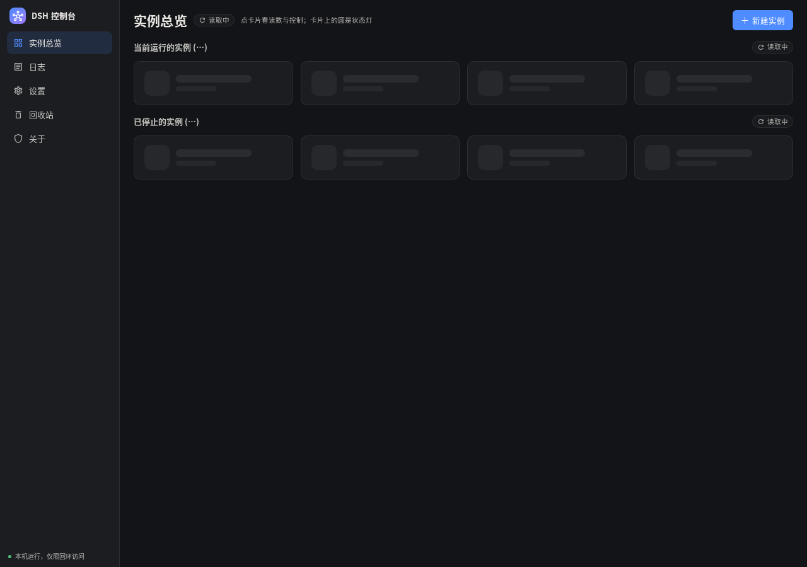
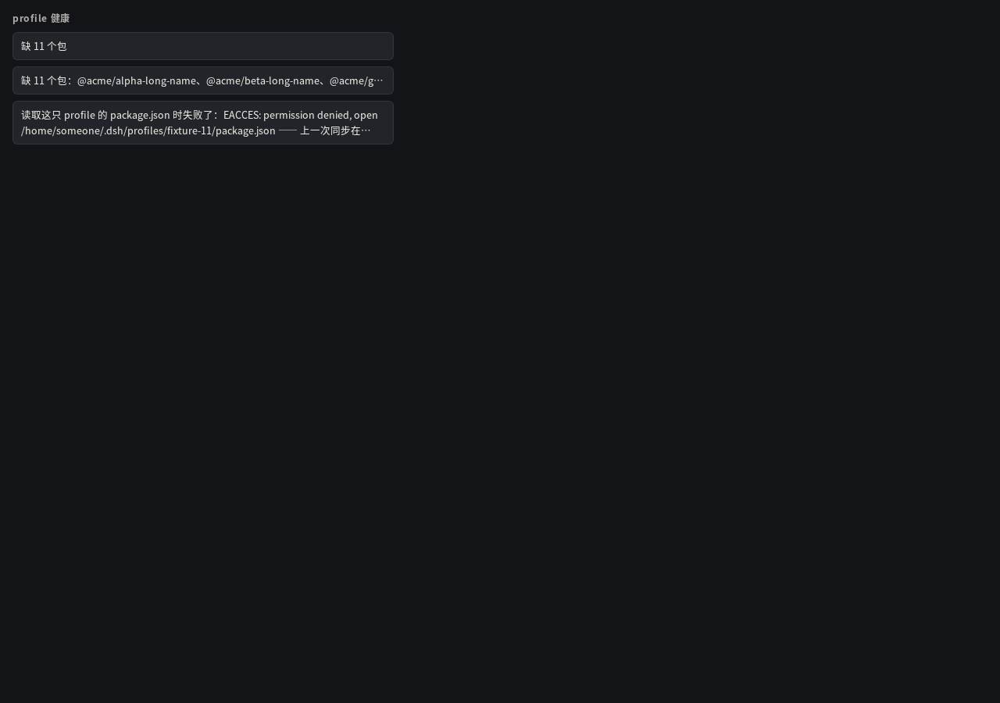

# 第十二轮 A / C：加载态那条 sr-only、抽屉问题提示的高度上限

两条改动都只落在 `frontend/`。证据由 `probe-hint-height.mjs` 一次跑出来：

```bash
# 隔离 fixture：DSH_HOME 指向一个临时 home（里面只有一只声明了 11 个包、一个都没装的 profile），
# XDG_STATE_HOME 也隔离；**不碰使用者的 ~/.dsh 与状态目录**
mkdir -p /tmp/dsh-hint-iso/dsh/profiles/fixture-11 /tmp/dsh-hint-iso/state
# package.json 的 dsh.profile.bundles 声明 11 个包、不放 node_modules → 11 个全缺
cd dsh-console/backend
DSH_HOME=/tmp/dsh-hint-iso/dsh XDG_STATE_HOME=/tmp/dsh-hint-iso/state DSH_CONSOLE_BACKEND_PORT=5392 \
  ./_build/native/debug/build/dsh-console-backend.exe &

cd dsh-console/frontend/evidence-hint-height
node probe-hint-height.mjs "$PWD" http://127.0.0.1:5392/
```

`probe-hint-height.mjs` 用 CDP 直接量，判据都是页面里的实测值，不是看截图猜的。

---

## 一、加载态那四句从可见位拿掉，只留一条看不见的

做法：`card_loading` 末尾那条状态说明挂上 `dsh-sr-only`（绝对定位 + 1px + clip + clip-path），
`role=status` 与 `aria-live=polite` 原样保留。**分组标题不动**（「当前运行的实例 (…)」/「已停止的实例 (…)」
是读哪一组的定位，不是加载态）。

量法：把 `/api/local/*` 用 CDP 的 `Fetch` 拦在半路不继续 —— 读数永远不回，页面就停在加载态那一帧。

| 判据 | 实测（`loading.json`） |
| --- | --- |
| 那一条还在 DOM 里 | `noteInDom: true`，`class="dsh-loading-note dsh-sr-only"` |
| 语义还在 | `role="status"`、`aria-live="polite"` |
| 视觉隐藏 | `position: absolute`、`width/height: 1px`、`clip: rect(0px, 0px, 0px, 0px)`、`clip-path: inset(50%)`；实测外框 `1×1` |
| 屏幕上一个像素都不占 | 骨架块的栅格行高 `70px`（与真条目同高），说明那一块不在文档流里 |
| 可见文本里没有那四句 | `visibleHasFour: [false,false,false,false]`（见下：可见性的判据） |
| 分组标题还看得见 | `headingsVisible: [true,true]` |
| 读屏照样读得到 | 无障碍树里四句都在，`ignored: false`（`StaticText`，挂在两个 `role=status` 节点下） |

**「可见文本」是怎么扫的**（`probe-hint-height.mjs` 里的 `visibleText()`）：
遍历所有文本节点，元素自己或**任一祖先**满足下面任一条就整条跳过 ——
`display:none` / `visibility:hidden` / `opacity:0`、外框 ≤ 2px、挂了 `clip-path`、挂了 `clip`。
（只按 `innerText` 扫是不够的：Chrome 的 `innerText` 会把被 clip 掉的文字也算进去。）



## 二、抽屉里问题提示的高度上限

按**我们预先知不知道它长什么样**分两类（不是按内容长短），形状在 `.dsh-problem` / `.dsh-problem-text` 里定死：

| 类别 | 正文 | 悬停 | 实测 |
| --- | --- | --- | --- |
| 已知且可枚举（缺 N 个包） | **一行**（nowrap + 省略号） | 完整清单 | 真抽屉：正文 `缺 11 个包`（7 字），`1 行`，卡片高 `36px`，悬停 `247 字`（11 个包名一个不落） |
| 已知、但正文长 | 仍**一行** + 省略号 | 全文 | fixture：`1 行`，`ellipsizedX: true` |
| 自由文本（后端报回来的错误串） | **最多两行**（`-webkit-line-clamp: 2`） | 原文 | fixture：`2 行`，卡片高 `56px`，`clamp: "2"`，悬停 `224 字` = 正文全文（`fullInTitle: true`） |

改动前后同一处的正文：`缺 11 个包：@acme/alpha-long-name、… （11 个包名，247 字）` → `缺 11 个包`（7 字）；
「profile 健康」那一节总高 `63px`，抽屉内容 `scrollHeight == clientHeight`（`841 / 841`，内容一屏放得下，不撑高）。

**一个踩到的坑（已修）**：`overflow` 裁在 **padding box** 上，卡片那 7px 下内边距会把第 3 行的字头露出来
（第一版就是这样，实测第 3 行顶进下内边距、露 7px 字头 ✗）。所以内边距归卡片、裁剪归里面那一层
`.dsh-problem-text`（`span`），裁剪区正好是内容盒。修完外框 `scrollHeight == clientHeight`（54/54），
放大图上字头干净了（`zoom-free.png`）。



**未知那一类今天没有生产者**：现在的读数只会给出「缺 N 个包 / 没有 cordis.patch.yml / 都对 / —」这几种
我们自己的措辞，后端还没有自由文本的错误串落进这一格。所以自由文本那一条走的是
`fixture-problem-hint.html` —— 它**用真抽屉里那条的同一段标记**（从 DOM 里取 `outerHTML`），只把
正文换成一条超长错误、class 加上 `is-free`，样式就是构建产物里的那一份 `app.css`。
等后端真把错误串递进来，接上 `health_free: true` 就会走同一副形状。

## 三、怎么复跑

```bash
node probe-hint-height.mjs <输出目录（绝对路径）> http://127.0.0.1:5392/
```

产物：`loading.json` / `loading.png`（加载态）、`drawer.json` / `drawer.png`（真抽屉、11 个缺包）、
`free.json` / `fixture-problem-hint.html` / `fixture-problem-hint.png` / `zoom-free.png`（两副形状）。
